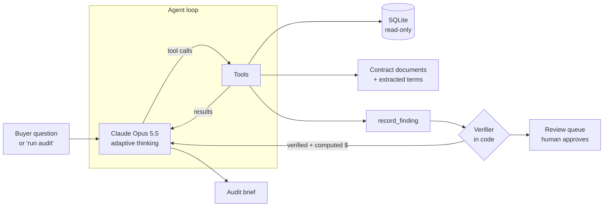

# Procurement Contract-Compliance Agent

An AI agent that audits purchase orders and supplier invoices against contracts. It finds where money is leaking, proves each finding with record IDs, and writes a brief a buyer can act on. Every finding is re-checked in code before anyone sees it, and anything uncertain goes to a human.

Built with the Claude API (Claude Opus 5.5), Python, SQLite and Streamlit. All data is synthetic.

> This is the follow-up to [spend-classifier](https://github.com/FrannyBrave/spend-classifier), which made one Claude call per PO line to categorize spend. This project is the next step up: an **agent** that decides which queries to run and which contracts to read, over many steps, to answer open questions about compliance.

---

## Why

Procurement teams sign contracts with fixed prices, rebates and terms, and then the money leaks:

- suppliers bill above the contract price
- people buy from off-contract vendors
- contracts expire while orders continue
- invoices don't match POs, or arrive twice
- rebates go unclaimed

Finding these means cross-checking thousands of rows against documents, which is slow, so it rarely gets done. This agent does that work in about two minutes for under $0.50, and shows its evidence.

## Results

Scored against an answer key of **26 planted issues worth $74,037.25** that the agent never sees:

| Eval | Result |
|---|---|
| **Full audit** (3 independent runs) | **100% precision, 100% recall** in every run. 26/26 issues and $74,037.25 found, 0 false positives |
| Cost and time per audit | $0.42–0.47 (mean $0.44) · 114–119 s · 44–49 tool calls |
| **Q&A** (10 questions with exact answers) | **10/10 correct** · mean $0.07 and 18 s per question |
| **Contract term extraction** | **100%** of 108 fields (prices, dates, terms, rebate rules) · $0.18 for all 10 contracts |

Model: Claude Opus 5.5, effort `medium`. Raw results are in [`results/`](results/).

The verifier, not the model, is the source of truth for dollar amounts. Across these runs, the agent's own claimed amounts matched the recomputed amounts on every finding.

**Honest caveat:** perfect scores mean this dataset no longer separates good from great. It's a regression baseline now, not a ceiling. The next step is harder data (see *What I'd do next*). The Q&A grader also only checks that the expected numbers and names appear in the answer, so it's lenient about wording.

The agent also avoided both traps planted in the data:
- **Q3 rebates:** earned but not yet due on the audit date, so they are not "missed".
- **Consulting spend:** a category with no contract at all, so buying off-contract there is allowed.

In one run it also raised a real ambiguity on its own. Whether a rebate threshold is measured on PO dates or invoice dates changes whether Q1 qualifies. It sent that finding to human review instead of claiming it.

## What it does

| Mode | What happens |
|---|---|
| **Ask** | Answer a question ("Which supplier overcharged us most?") with numbers and record IDs, with every step visible. |
| **Audit** | Sweep all six issue types, record each finding with evidence, then write a brief: dollars at risk, top findings, recommended actions, items for review. |
| **Review queue** | A person approves or rejects findings the verifier couldn't confirm or the agent wasn't sure about, and can have the agent draft a dispute email (draft only, never sent). |
| **MCP server** | The same read-only tools, available to any MCP client (Claude Desktop, Claude Code, other agent platforms). |

Issue types: price above contract · off-contract (maverick) spend · purchases on an expired contract · invoice ≠ PO · duplicate invoice · missed volume rebate.

## How it works



1. **Contract term extraction:** contracts are written in different styles (tables and prose). A one-time step uses Claude with structured outputs to pull prices, dates, payment terms and rebate rules into JSON. Scored field by field: **100% of 108 fields**.
2. **Agent loop** ([agent/loop.py](agent/loop.py)): a hand-written loop, with no framework, so every step is visible. Claude decides which tool to call. The loop runs it, returns the result, and repeats until Claude answers.
3. **Tools** ([agent/tools.py](agent/tools.py)): `describe_schema`, `run_sql`, `list_contracts`, `get_contract`, `get_contract_terms`, `record_finding`, `draft_supplier_email`. All schemas use strict mode.
4. **Verifier** ([agent/verify.py](agent/verify.py)): when the agent records a finding, code immediately re-checks it against the data. Do the cited IDs exist? Does the issue really hold? What is the actual dollar amount? The result goes back to the agent, which can correct itself. A made-up ID or a wrong amount can't reach the buyer unflagged.

### Guardrails

| Risk | Control |
|---|---|
| Agent changes data | The database opens read-only, a SQL guard allows only a single SELECT, and `query_only` is on: three independent layers |
| Runaway query | 5-second timeout, 200-row cap |
| Hallucinated finding or amount | Code verifies every finding; unverified findings go to human review |
| Uncertain judgment | Confidence below 0.8 goes to human review |
| Runaway cost | Per-run budgets: 60 tool calls and $3. When a budget runs out, the agent's tools switch off and it writes up what it has |
| Acting on a supplier | No send capability; emails are saved as drafts |
| Model refusal | Server-side fallback to another model, and a clean stop if the request is still refused |
| Truncated tool call | Never executed (`max_tokens` stop is handled) |
| Answer-key leakage | The agent's tools cannot read `data/answers/` |

## Run it

```bash
git clone https://github.com/FrannyBrave/procurement-compliance-agent.git
cd procurement-compliance-agent
python3 -m venv .venv && source .venv/bin/activate
pip install -r requirements.txt
cp .env.example .env        # then add your ANTHROPIC_API_KEY
```

```bash
streamlit run app.py                        # UI (demo mode works without a key)
python -m agent.loop ask "Which supplier overcharged us the most?"
python -m agent.loop audit                  # full audit in the terminal
python evals/run_eval.py --audit-runs 3 --qa
pytest -q                                   # 32 tests, no API calls
```

Regenerate the data with `python data/generate.py` (seeded, so it is reproducible), and re-extract contract terms with `python -m agent.extract_terms`.

### Use the tools from Claude Desktop (MCP)

Add this to `claude_desktop_config.json`:

```json
{
  "mcpServers": {
    "procurement-compliance": {
      "command": "/path/to/procurement-compliance-agent/.venv/bin/python",
      "args": ["/path/to/procurement-compliance-agent/mcp_server.py"]
    }
  }
}
```

## Project structure

```
agent/
  loop.py           the agent loop: budgets, tracing, refusal and truncation handling
  tools.py          tool schemas (strict) and handlers
  verify.py         deterministic verification of findings
  db.py             read-only SQLite access and SQL guard
  prompts.py        system prompt and task templates
  extract_terms.py  contract term extraction with structured outputs + its eval
  config.py         model, effort, budgets, pricing
data/
  generate.py       seeded synthetic data with planted issues
  contracts/        contract documents (+ terms.json from extraction)
  answers/          answer key, used only by evals and tests
evals/run_eval.py   audit eval (precision/recall per issue type) and Q&A eval
app.py              Streamlit UI
mcp_server.py       MCP server
results/            saved runs and eval results (power the demo mode)
tests/              32 tests, no API calls (the loop is tested with a scripted fake client)
```

## Design decisions

- **A hand-written loop instead of a framework.** The core loop is about 120 lines, and owning it is what lets me add budgets, a forced wrap-up, tracing and per-step verification in one place.
- **Verify in code, not with a second LLM.** Compliance findings are checkable facts. A deterministic check is cheaper, faster and more trustworthy than an LLM judge, and it tells the agent exactly what's wrong.
- **One finding per record.** This makes findings individually reviewable and lets the eval match them exactly.
- **A planted-issue answer key.** Agent quality is measured, not eyeballed. Precision, recall and dollars are tracked per issue type across repeated runs, because one good run can be luck.
- **Effort `medium`.** It reached full recall at about $0.50 per audit. Raising it is a cost lever to test against the eval, not a default.

## What I'd do next

- Connect to a real ERP or P2P system (e.g. SAP Ariba or Coupa exports) instead of SQLite, through the same MCP tools
- Run on a schedule and post new findings to Slack or Teams for the category manager
- Keep approved and rejected review decisions as feedback to tune the prompt and thresholds
- Harder data: fuzzy supplier names, price escalation clauses, partial deliveries, credit notes
- A model and effort comparison on the same eval (Opus vs Sonnet vs Haiku), as in spend-classifier

---

Built with [Claude Code](https://claude.com/claude-code). All suppliers, contracts and transactions are synthetic.
